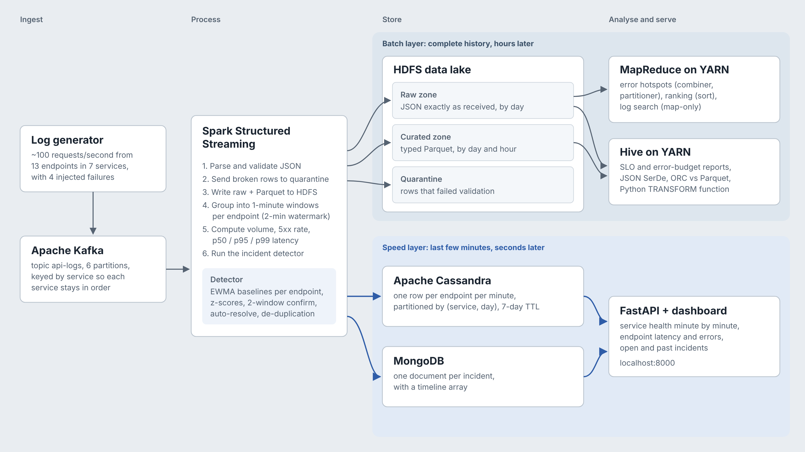
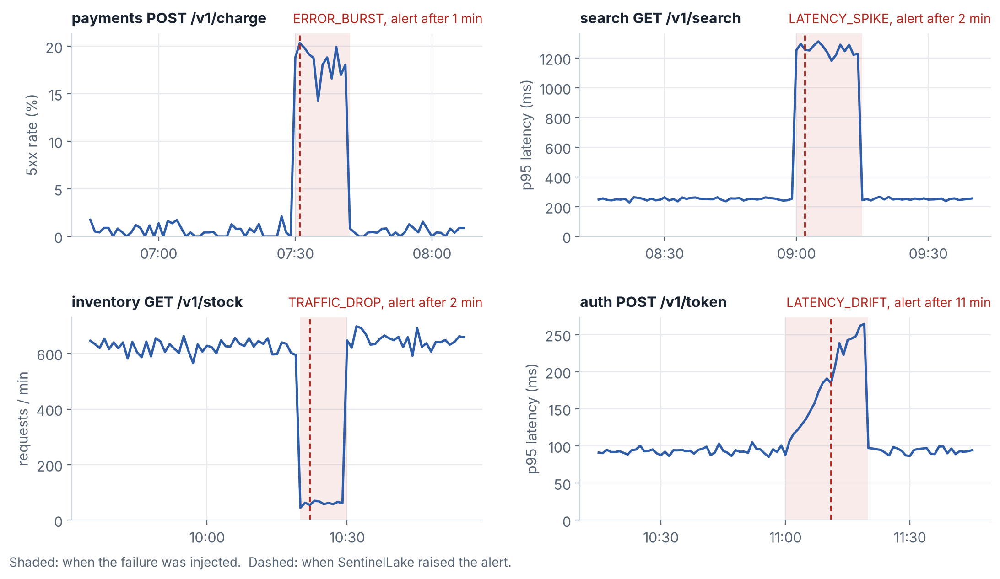
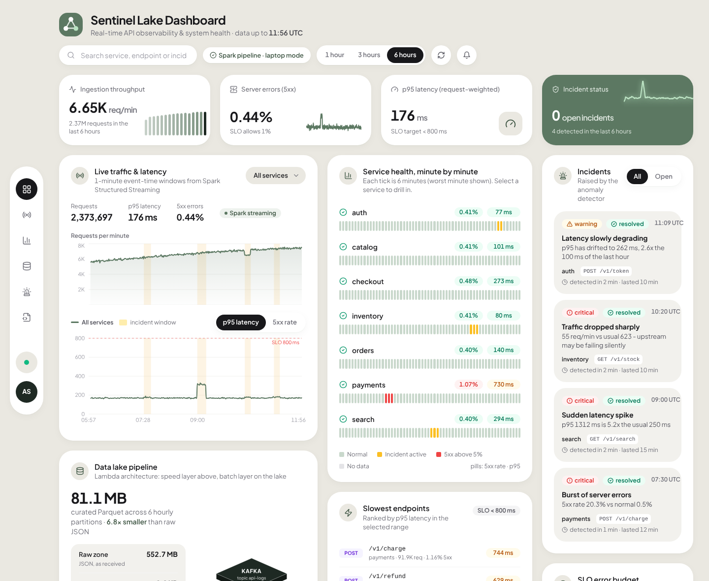

# SentinelLake


**A streaming data lake that watches API traffic and raises an incident within minutes of something breaking.**

Every request to a fleet of microservices leaves a log line. SentinelLake ingests those logs through Kafka, processes them with Spark Structured Streaming, keeps the full history in an HDFS data lake for MapReduce and Hive, serves live per-minute metrics from Cassandra and incidents from MongoDB, and shows it all on an on-call dashboard.

The traffic is synthetic but realistic: 7 services, 13 endpoints, about 100 requests a second, with four known failures injected on schedule. That makes the detector measurable. On a 6-hour replay (2.4 million requests) it caught **all 4 failures with 0 false alarms**, and the result held across 5 independently generated days (20 of 20 detected, 0 false alarms).



## Results

All numbers come from `results/` and were measured on a 2-core, 8 GB machine with Spark in local mode. Rerun them with `make bench evaluate`.

| What was measured | Result |
|---|---|
| Failures detected (6-hour replay, 4 injected) | 4 of 4, 0 false positives |
| Same, over 5 independently generated days | 20 of 20, 0 false positives |
| Time to alert: error burst / latency spike / traffic drop | 1 / 2 / 2 minutes |
| Time to alert: slow latency drift (×3 over 20 min) | 10–13 minutes |
| Streaming throughput, all four outputs running | ~16,700 events/s (2.4M events in 144 s) |
| Storage: Parquet (snappy) vs raw JSON | 77 MB vs 527 MB, 6.8× smaller |
| Same analytical query: Parquet vs JSON | 1.3 s vs 4.9 s, 3.9× faster |
| MapReduce shuffle with vs without combiner | 46 KB vs 97 MB, 99.95% less data moved |





## How it maps to the course (AIM4140 Big Data Analytics)

| Syllabus topic | Where it lives |
|---|---|
| 3Vs, types of digital data | 2.4M semi-structured JSON events/6 h (volume), seconds-level latency (velocity), typed + raw + document + time-series stores (variety) |
| CAP theorem, BASE | Cassandra (AP, tunable consistency) for metrics vs MongoDB (CP, single primary) for incidents; idempotent upserts vs non-idempotent counters, see [DESIGN.md](docs/DESIGN.md) |
| SQL vs NoSQL vs NewSQL | query-first Cassandra tables, document model for incidents, Hive SQL on the lake |
| HDFS, NameNode/DataNode | `docker/hadoop`, lake zones under `/sentinellake` |
| MapReduce: Mapper, Reducer, Combiner, Partitioner | `mapreduce/jobs/hotspots_*` with `KeyFieldBasedPartitioner` |
| Searching, sorting, compression | map-only search job, total sort with `KeyFieldBasedComparator -k1,1nr`, Snappy shuffle + Gzip output |
| Hadoop 2 / YARN | MapReduce and Hive both run as YARN applications (`resourcemanager`, `nodemanager`, history server) |
| MongoDB: CRUD, arrays, aggregate, mapReduce, cursors, indexes, import/export | `storage/mongo/queries.js` |
| Cassandra: keyspaces, CQLSH, CRUD, collections, counter, TTL, ALTER, COPY, system tables | `storage/cassandra/*.cql` |
| Hive: architecture, data types, file formats, HQL, SerDe, UDF | `hive/*.hql` (JSON SerDe, Parquet vs ORC, TRANSFORM script) |
| Emerging tech (Spark, Kafka, data lakes) | Kafka KRaft, Spark Structured Streaming, raw/curated lake zones |

## Run it

### Laptop mode (no Docker, about 5 minutes)

Needs Python 3.10+ and Java 17. This runs the real Spark job, the real MapReduce scripts (through a local shuffle simulator) and the dashboard, with JSONL files standing in for Kafka, Cassandra and MongoDB.

```bash
make setup     # virtualenv + dependencies
make demo      # simulate 6 h of traffic -> Spark -> detector -> scores -> dashboard on :8000
make test      # 46 tests: generator, detector, MapReduce, Spark transforms, HiveQL, API
make hive-local  # the HiveQL reports, run on Spark SQL over the local lake
```

### Windows (VS Code or any terminal, no WSL needed)

Laptop mode runs natively on Windows. One-time prerequisites:

1. **Python 3.12** from python.org (64-bit installer).
2. **Java 17**: Eclipse Temurin 17 (`.msi`), with *Set JAVA_HOME variable* enabled.
3. **Hadoop helpers**: `winutils.exe` and `hadoop.dll` from [cdarlint/winutils](https://github.com/cdarlint/winutils) (`hadoop-3.3.5/bin`) in `D:\hadoop\bin`, then in PowerShell:
   ```powershell
   [Environment]::SetEnvironmentVariable("HADOOP_HOME", "D:\hadoop", "User")
   [Environment]::SetEnvironmentVariable("Path", "D:\hadoop\bin;" + [Environment]::GetEnvironmentVariable("Path", "User"), "User")
   ```

Then, from a normal PowerShell window in the project folder (a path without spaces):
```powershell
powershell -ExecutionPolicy Bypass -File setup_windows.ps1   # creates .venv, installs, checks Java/Hadoop/Spark
.\sl test      # 46 passed
.\sl demo      # dashboard on http://localhost:8000
```
`sl.cmd` runs any task with the project's own Python, so there is nothing to activate; `.\sl` lists every task. In VS Code, the Run and Debug panel (Ctrl+Shift+D) has the same tasks as buttons.

### Cluster mode (Docker)

Needs Docker with about 8 GB of memory for the streaming stack, 11 GB with the batch layer.

```bash
make up            # or: python tasks.py up   (Kafka, HDFS, Spark, Cassandra, MongoDB, generator, API)
open http://localhost:8000      # first incident appears about 15 minutes in (--demo schedule)
make logs          # watch the streaming job report windows and incidents

make batch-up      # add YARN, MapReduce history server, Hive
make mapreduce     # 3 MapReduce jobs on YARN over today's raw zone
make hive          # create tables, run the SLO / error-budget queries
make cassandra-demo mongo-demo
```

Web UIs: dashboard `:8000`, HDFS `:9870`, Spark `:8080`, Spark job `:4040`, YARN `:8088`, job history `:19888`, HiveServer2 `:10002`.

## Repository

```
sentinellake/        generator, detector, Spark streaming job and sinks
mapreduce/           Hadoop Streaming jobs (Python) + YARN runner + local runner
hive/                tables, analytics, TRANSFORM UDF
storage/             Cassandra schema and CQL walkthrough, MongoDB setup and queries
api/                 FastAPI service; serves the built dashboard (no CDN, works offline)
ui/                  dashboard source: React, Tailwind CSS, Recharts, Lucide (built into api/static/app)
benchmarks/          detection scoring, robustness, storage/query benchmarks, charts
tasks.py             cross-platform task runner (Windows-friendly alternative to make)
docker/              Hadoop 3.3.6 + Hive 4.0.1 image, Spark 3.5.3 image, app image
tests/               pytest suite
docs/                design notes, architecture diagram, figures
```

## Live demo

The dashboard and API are hosted on Render, serving the output of one 6-hour replay (`demo/`):
**https://sentinellake.onrender.com** (free tier: the first visit after a quiet spell takes about a minute to wake up).
Kafka, Spark, HDFS, Cassandra and MongoDB are not hosted; run them with laptop or cluster mode below.

To host your own copy: push the repo to GitHub, then on Render choose **New → Blueprint** and pick the repo. `render.yaml` does the rest.

## Dashboard

The on-call dashboard is a React app (`ui/`) styled with Tailwind CSS, charts in Recharts and icons from Lucide. Its production build is committed in `api/static/app`, so running the project needs no Node.js; FastAPI serves it at `/`. Every figure on it comes from the API (`/api/overview`, `/api/fleet`, `/api/incidents`, `/api/lake`, `/health`), and the first, minimal console is kept at `/classic`.

To change the UI (needs Node 18+): `cd ui && npm install && npm run dev` (hot reload, proxies the API on :8000), then `npm run build`.

## Design decisions

The short version, with the reasoning in [docs/DESIGN.md](docs/DESIGN.md):

- **Two storage paths.** History goes to HDFS (cheap, complete, slow to query point lookups); the last week of minute metrics goes to Cassandra (fast reads by service and time). This is the Lambda architecture's batch and speed layers.
- **Finalised windows only.** Metrics are emitted once a window closes (2-minute watermark), so the detector never sees a half-filled minute. The cost is up to ~3 minutes of latency.
- **Detector learns only from healthy minutes.** Otherwise a long outage would become the new normal.
- **A fast and a slow baseline.** The fast one catches spikes; the slow one catches drift the fast one adapts to.
- **Replays are harmless.** Metrics are Cassandra upserts and incidents have deterministic ids, so reprocessing a micro-batch after a crash doesn't duplicate anything. Counters are the deliberate exception.

## Limitations and next steps

- The detector's state lives in the Spark driver; a restart re-learns baselines (~10 minutes). Next: persist baselines to Cassandra.
- Single-node HDFS and Cassandra (replication factor 1). Production would use 3 replicas and `NetworkTopologyStrategy`.
- Drifts slower than about 8% per minute are not caught in real time; the hourly Hive SLO report is the safety net.
- Alerts are shown on the dashboard only. Next: Slack or email notification on `opened`.

## Tech stack

Kafka 3.8 (KRaft) · Spark 3.5.3 Structured Streaming · Hadoop 3.3.6 (HDFS, YARN, MapReduce Streaming) · Hive 4.0.1 · Cassandra 5.0 · MongoDB 7.0 · Python 3, FastAPI, React + Tailwind CSS + Recharts · Docker Compose · pytest

## Author

**Anushka Srivastava**, B.Tech CSE (AI & ML), Manipal University Jaipur
[LinkedIn](https://www.linkedin.com/in/anushka0904) | [GitHub](https://github.com/anu091104)

Built as the course project for Big Data Analytics (AIM4140), 2026. Released under the [MIT License](LICENSE).
